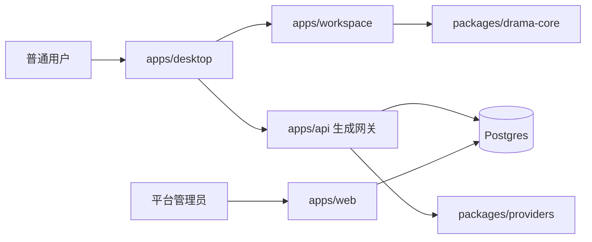

# 开镜（Kaijing）

开源的 AI 短剧 / 漫剧制作工具。仓库：[openroute-ai/vercelai-kaijing](https://github.com/openroute-ai/vercelai-kaijing)。平台域名：vercelai.cn。

一期面向普通用户的交付是 **Windows / macOS 桌面客户端 + 薄云**。薄云只做登录、积分和统一生成网关。完整浏览器工作台放在二期。

工作台是上游画布的 Apache-2.0 源码副本（提交 `174e652451a3533c20462acb7380008428670ff6`，见 `apps/workspace/UPSTREAM.md` 和 `NOTICE`）。产品名是开镜。短剧导演和真实供应商调用还没做。

## 架构

```text
apps/desktop        Electron 壳。开发时打开本机工作台
apps/workspace      Vite + React 本机工作台（画布 / 创作台 / 素材，不是 Next.js）
apps/web            Next.js 薄云控制台：登录、账户、积分、生成任务
apps/api            Hono OpenAPI：健康检查 + 生成任务占位
apps/docs           Fumadocs 文档站

packages/drama-core 剧本、分镜、角色、场景、镜头与命令内核类型
packages/providers  生成供应商接口（M0 只有 stub）
packages/db         Postgres：better-auth、积分、生成任务元数据
packages/auth       better-auth
packages/ui         shadcn/ui
packages/email packages/sms-captcha packages/redis packages/storage
```



本机工作台以后负责项目、画布、时间线和导出。云端默认不托管成片。

## 技术栈

| 层 | 技术 |
| --- | --- |
| 工作台 | Vite 8、TanStack Start、React 19、Tailwind CSS v4、本机 SQLite |
| 桌面壳 | Electron |
| 薄云 / 文档 | Next.js 16 |
| API | Hono 4 + zod-openapi |
| 数据 | Drizzle ORM + PostgreSQL |
| 认证 | better-auth |
| 构建 | pnpm 10 + Turborepo |

许可保持 **LGPL-2.1**（见 `LICENSE`）。

## 快速开始

```bash
pnpm install
cp .env.example .env
docker compose up -d
pnpm --filter @workspace/db db:migrate
```

工作台（浏览器）。第一次会准备本机 SQLite：

```bash
pnpm --filter workspace db:push
pnpm --filter workspace dev
# http://127.0.0.1:3020
```

首页可以进创作台和画布。云端账户在 http://127.0.0.1:3020/cloud-account ，请求会由 Vite 转发到 `http://127.0.0.1:8080`。

桌面壳（先启动工作台，再开另一个终端）：

```bash
pnpm --filter desktop dev
```

桌面进程会加载 `KAIJING_WORKSPACE_URL`，默认 `http://127.0.0.1:3020`。

两套登录：

- 桌面 / 工作台用户：`cloud` realm，cookie 名 `cloud.session_token`。接口是 `POST /api/v1/cloud/register` 和 `POST /api/v1/cloud/login`。
- 平台运营：`apps/web`，cookie 前缀 `web`，数据在 `web_auth` schema，不和桌面会话共用。

薄云控制台与 API：

```bash
pnpm --filter web dev     # http://localhost:30051  平台运营
pnpm --filter api dev     # http://localhost:8080   云端账户和生成网关
pnpm --filter doc dev     # http://localhost:6969
```

生成任务占位：

```bash
curl -X POST http://localhost:8080/api/v1/generations \
  -H 'content-type: application/json' \
  -H 'origin: http://localhost:8080' \
  -d '{"kind":"image","prompt":"角色正面"}'
```

`/api/v1` 带 CSRF 校验，本地调用需要带允许的 `Origin`。这条接口只把任务记成 `queued`，不会请求任何模型厂商。

## 常用命令

```bash
pnpm dev
pnpm lint
pnpm typecheck
pnpm build

pnpm --filter @workspace/db db:generate
pnpm --filter @workspace/db db:migrate
pnpm --filter @workspace/db db:seed:admin
```

## 文档

- 功能设计（三份上游怎么做成开镜，含路径、领域、命令和里程碑）：[docs/design/INDEX.md](docs/design/INDEX.md)
- 交互与界面（屏幕、操作和状态）：[docs/ued/INDEX.md](docs/ued/INDEX.md)
- 协作三档（本轮只写设计，一期仍是单人）：[docs/design/collaboration.md](docs/design/collaboration.md)
- 文档索引：[docs/README.md](docs/README.md)
- 一期架构简图：[docs/design/phase-1.md](docs/design/phase-1.md)
- 开发约定：[AGENTS.md](AGENTS.md)

## 这一版做到哪

- 桌面用户和平台运营的注册、登录都走 better-auth。`/api/v1/cloud/register` 与 `/login` 是 `cloud` 实例的薄包装；`apps/web` 使用 `web` cookie 和 `web_auth`，两套会话不共用
- 工作台 `/drama` 可以手写一稿剧本和一版分镜，写入本机 SQLite 的 `drama_*` 表。不调用模型
- 协作只写了设计，见 `docs/design/collaboration.md`

## 这一版不做

- 不内置短剧导演，不调用模型改写，不把生成接到真实供应商，不导出成片
- 不引入 Toonflow 的 Vue 界面，不复制火宝短剧源码
- 不把工作台改写成 Next.js
- 不做导出互传、只读分享或同时编辑
