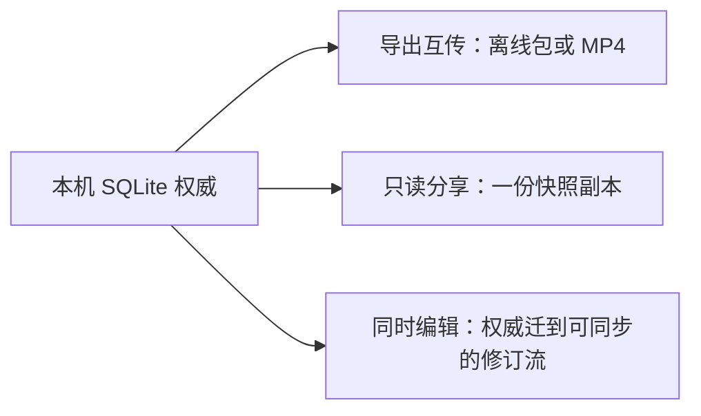

# 协作

一期仍然是单人桌面。本机 SQLite 是项目、画布、时间线、素材和 `drama_*` 的权威。薄云只保存账户、积分和生成任务。这一章把以后可能出现的三种协作强度写到可以照着实现，并说明每一种相对现在的架构要改多大。本轮不实现其中任何一种，也不加同步接口。

三种强度不要混成「再加几个云端路由」。导出互传不产生共享中的项目。只读分享有一个写作者和若干看的人。同时编辑才是二期的「完整浏览器协作」，项目权威必须离开单机 SQLite。

## 0. 现在不能被协作改掉的约束

- 一个本地 `projectId` 上的画布、时间线、素材和短剧表只由这一台机器上的命令内核写入。
- 薄云不保存剧本正文、分镜、画布坐标或成片。
- `apps/web` 的运营会话（cookie 前缀 `web`，`web_auth`）不能打开用户画布，也不能冒充 `cloud` 会话。
- 登录和注册只走 better-auth。协作如果要认人，认的是 `cloud` 这套 better-auth 用户，不另做密码或 JWT。

## 1. 导出互传

这是相对现在最小的改动。没有共享中的项目，没有在线状态，也没有冲突合并。一个人把项目包或已经导出的 MP4 用网盘、邮件、U 盘交给另一个人。接收方在自己的机器上得到一份新的本地项目，两边之后各改各的。

### 项目包里有什么

一个 zip（或等价的目录）。清单用 JSON，媒体用相对路径，不用源机器的绝对路径。

| 内容 | 来源 |
| --- | --- |
| `manifest.json`：格式版本、导出时间、来源 `projectId`（仅作溯源，导入时分配新 id） | 导出命令现写 |
| 项目名、简介 | 现有 `project` |
| `drama_projects`、`drama_scripts`、`drama_characters`、`drama_scenes`、`drama_props`、`drama_storyboards`、`drama_shots`、`drama_runs` | 本机短剧表。`revision` 原样带上 |
| 画布快照、时间线文档、组织状态 | 现有 snapshot / timeline JSON |
| `media/` 下被这些对象引用的素材文件，以及素材 id、mime、时长 | 本机媒体目录 |
| 可选：已经渲染好的 MP4 | 用户选择的成片，不代替项目包 |

只传 MP4 时连项目包都不要。那就是 M6 的导出，接收方不能继续改剧本。它比项目包更小，也不碰命令内核。

### 留在本机、不放进包里的

- `cloud.session_token` 和任何 better-auth 会话
- 积分余额、`credit_ledger`、Postgres 里的 `generation_jobs` 行
- 供应商密钥、`BETTER_AUTH_SECRET`
- 本机绝对路径、操作系统用户名
- 云端任务 id 可以当作不透明字符串留在镜头的错误信息里，但导入方不能靠它去查别人的任务

导入时：

1. 新建本地项目，所有 id 重写，包内引用一起改。
2. 走现有命令内核写入画布和时间线，短剧表走和手写保存相同的持久化边界。界面不直接 `INSERT`。
3. 缺文件就标成缺失素材，不因为缺一张图拒绝整包。
4. 不覆盖接收方已有项目。冲突的含义是「这是一份副本」，不是两人同时改同一行。

### 改动量

工作台增加导出和导入两个命令，外加一个选文件的界面。薄云不加表、不加权限。不改「本机 SQLite 是权威」。这是三种里面唯一可以在一期单人模型上后补的能力，但本轮仍然不做。

## 2. 只读分享

一个人编辑，其他人可以看，或者只能留言，不能改同一份 SQLite。相对现在是中等改动：项目字节必须离开编辑者的机器，但写权威仍然是那一份本机库。

### 必须出现在云上或同步副本里的

编辑者在本机点「分享」之后，工作台打出一个和导出包相同结构的快照，上传到薄云或对象存储。云上至少有：

| 对象 | 作用 |
| --- | --- |
| `project_shares` | `shareId`、拥有者的 `cloud` 用户 id、模式 `view` 或 `comment`、过期时间、是否撤销 |
| 快照对象 | 剧本、分镜、画布快照、时间线。按分享版本存，不把编辑者的 SQLite 文件本身挂到网上 |
| 媒体 | 观看者要看到的图片和视频。用对象存储和限时 URL，不把编辑者磁盘暴露出去 |
| `project_share_comments` | 只在模式为 `comment` 时存在。挂在 `shareId` 和镜头 id 或画布卡片 id 上 |

编辑者之后又改了本机项目，观看者不会自动看到，除非编辑者再次发布快照。观看者的留言不写回编辑者的 SQLite，除非编辑者显式拉取。拉取也走命令，不让观看者连上那台机器的数据库。

### 权限

- 创建、撤销、重新发布：只有该分享的 `cloud` 用户（better-auth 会话）。
- 打开观看页：持有链接的人还要有自己的 `cloud` 会话。链接本身不是写权限，也不是运营后台的权限。
- `view` 不能发留言。`comment` 只能新增留言，不能改剧本、分镜、画布或时间线。
- 撤销后，快照和媒体 URL 立即失效。已下载到观看者自己机器上的副本不在这条链路里，那是导出互传。

### 运营后台不能进画布

`apps/web` 可以有一张分享审核表：谁在何时创建、何时撤销、被举报次数。这张表只放元数据。

禁止：

- 用 `web.session_token` 调用快照或媒体接口
- 在运营后台渲染剧本正文、分镜、画布或播放成片
- 给运营一个「打开该用户项目」的入口
- 把 `web_auth` 用户写进 `project_shares.owner`
- 让运营会话通过 `/api/v1/cloud/*` 冒充桌面用户

观看接口只接受 `cloud` better-auth 会话，并且分享记录必须匹配。元数据接口可以接受 `web` 会话，响应里不带快照正文。两套 cookie 继续不通用。

### 改动量

要新增云表、上传、观看壳（不是编辑器）、分享权限。编辑者的命令内核和本机 SQLite 仍然是唯一写入口。不做在线状态，不做两人同时改同一镜。这比导出大，因为它把项目内容放到了云上，并第一次出现「这个 cloud 用户能不能看」的授权。它仍然不是二期的完整协作。

## 3. 同时编辑

多人同时改剧本、画布或时间线。这是二期「完整浏览器协作」那一类工作，不是在薄云上多加几个 JSON 接口。

### 权威必须离开单机 SQLite

现在的修订号 `expectedRevision` 只在一台机器的一个写队列里有意义。两人同时改，必须有一个跨客户端的修订权威，二选一：

1. 云端（或单独的同步服务）保存命令日志，每台电脑是副本。本地 SQLite 变成缓存，不再是唯一权威。
2. 指定一台主机的 SQLite 仍是权威，其他人的命令经中继提交。主机不在线就不能写。这仍然不是「每个浏览器各有一份权威库」。

无论哪一种，短剧表、画布快照和时间线都不再是「只存在于编辑者磁盘上的那一个文件」。领域文档里「本机 SQLite 是权威」这条要改掉，所以它不属于一期。

### 还要一起做的

| 能力 | 原因 |
| --- | --- |
| 在线状态 | 谁在看哪一镜、哪张卡片，避免两个人以为自己独占 |
| 冲突和修订 | 沿用命令信封里的 `expectedRevision`、`commandId`、`idempotencyKey`，但校验发生在共享权威上。冲突返回和现在的修订冲突一样可区分，不能后写的静默覆盖 |
| 媒体上传 | 参与者都要能解析素材 id。只存在于某台电脑上的文件，别人的画布会断 |
| 授权 | 每个命令都要知道 cloud 用户是这个项目的编辑者还是观看者。观看者的命令在权威处拒绝，不只是把按钮藏起来 |
| 登录 | 仍然只用 better-auth 的 `cloud` 会话。不引入第三套账号。运营的 `web` 会话不能成为项目成员 |

剧本、画布、时间线可以分期开放同时编辑，但存储模型一旦改成共享权威，三种表面就都要走同一条命令日志。不要做成「剧本用云表、画布仍用某人的 SQLite」这种分叉。

### 改动量

这是大改：项目权威迁移或复制、在线状态、跨人修订、媒体上传、按项目成员授权，以及一个真正的浏览器编辑器。薄云会从「账户、积分、任务」变成项目数据的一等存储。一期的桌面单人路径不能靠这个才成立。在权威迁移做完之前，禁止把现有命令内核暴露成公网可写接口。

## 4. 和里程碑的关系

| 强度 | 相对现在 | 放在哪 |
| --- | --- | --- |
| 导出互传 | 小。本机多两个命令 | 可以排在一期单人闭环之后，本轮不做 |
| 只读分享 | 中。快照、媒体、分享权限；写权威仍在本机 | 仍是单写者。运营不能进画布 |
| 同时编辑 | 大。权威离开单机 SQLite | 二期「完整浏览器协作」 |

一期完成的定义不变：安装、用 better-auth 登录、在本机做一集、导出 MP4。协作三档都不是这个定义的一部分。
