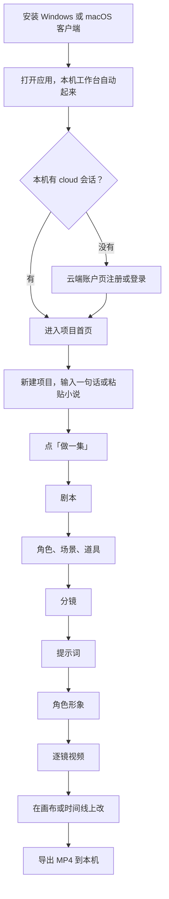

# 使用路径

一期完成的定义是：没参与开发的人，安装客户端，登录，用一句话做出一集，再导出 MP4。开发态的 `pnpm dev` 只给实现阶段用，不能代替这条路径。

## 1. 普通用户：安装到导出

逐步约定：

1. 用户从 vercelai.cn 下载安装包（M6）。开发期用 `pnpm --filter desktop dev`，窗口加载 `http://127.0.0.1:3020`。
2. 应用打开后不要求用户装 Node，也不打开终端。
3. 没有 `cloud.session_token` 时，进入工作台里的「云端账户」而不是 `apps/web` 的运营登录。注册走 `POST /api/v1/cloud/register`，登录走 `POST /api/v1/cloud/login`。这两个路径是 better-auth 的薄包装，cookie 由 `cloud` 这套 better-auth 签发。运营登录和注册走 `apps/web` 里另一份 better-auth，cookie 前缀是 `web`。成功后本机只保存会话用途，不把项目上传。
4. 首页沿用现在的项目列表。新建项目仍是现有的本地项目，短剧数据挂在这个 `projectId` 上。
5. 用户在短剧面板输入一句话，或粘贴更长的小说，选择集标题和画质档位（快速 / 标准），点「做一集」。
6. 内置导演按 [commands.md](commands.md) 的顺序调用命令。每一步完成后面板展示结果，用户可以改剧本、改名字、删一镜、换参考图，再从该步继续。
7. 生图和生视频时，本机代理向薄云提交任务。积分不够就停在这一步，已经做好的剧本和分镜还在。
8. 角色图和镜头视频回到本机素材库，并出现在画布上。用户可以拖位置、换连线、在时间线上剪一刀。这些编辑不反向覆盖剧本正文，除非用户在短剧面板里明确保存。
9. 「导出」把当前时间线渲染成 MP4，写到用户选择的目录。不自动上传。

普通用户不需要：

- 申请各家模型密钥
- 理解 MCP 或命令名
- 登录平台运营后台

### 中途失败

| 情况 | 行为 |
| --- | --- |
| 未登录就点生成 | 打开云端账户页。剧本草稿若已在本机写好，保留 |
| 密码错误 | 停留在云端账户页，沿用接口返回的「账号或密码错误」 |
| 积分不足 | 命令返回失败，镜头状态保持 `prompted` 或 `failed`，不扣成负数余额之外的透支 |
| 供应商失败 | 云端任务 `failed`，预扣积分释放。本机镜头标 `failed`，可以只重试这一镜 |
| 修订冲突 | 沿用现有命令内核的冲突重试。导演不直接覆盖用户刚改过的时间线 |
| 导出时 ffmpeg 不可用 | 导出命令失败并说明原因，不把半成品登记成已完成的成片 |
| 退出应用 | 本机 SQLite 和已下载素材还在。云端只留账户、积分流水和任务状态 |

## 2. 专业用户：同一套命令走 MCP

专业用户可以不点「做一集」，而用 MCP 按步调用 `drama.*`。工具名、入参和界面按钮背后的命令相同，`origin` 分别是 `mcp` 和 `ui`。

MCP 不是普通用户的前提。安装包默认不要求配置 Cursor。导演技能只是把步骤顺序写给代理和给内部编排器共用，见 [commands.md](commands.md)。

## 3. 平台运营：只看账户和任务

运营人员打开 `apps/web`（开发期 `http://localhost:30051`），使用 `web` cookie 前缀和 `web_auth` schema。这个会话不能调用桌面的云端账户接口，桌面的 `cloud.session_token` 也不能进入运营台。

运营路径：

1. 用平台管理员账号登录。登录页文案标明这是平台运营，不是桌面用户注册。
2. 在用户列表里查看 `public.users` 中的云端账户，封禁只影响云端登录，不删除对方电脑上的项目。
3. 在积分页按用户查看余额。调整余额写 `credit_ledger`，原因是 `grant` 或 `adjust`，并留下备注。
4. 在生成任务页查看 `generation_jobs`：状态、供应商 id、种类、错误信息、积分花费。这里没有剧本正文的编辑器；`prompt` 和 `request_json` 只为排障。
5. 运营不能替用户改分镜、不能下载用户的成片，也不能看见用户本机路径。

邀请和站内信保持现在的运营能力，不扩展成「邀请某人进入某个短剧项目」。一期项目不在云端共享。

## 4. 开发者在本仓库里的对应入口

| 想验证的路径 | 现在就能打开的入口 | 还没做的部分 |
| --- | --- | --- |
| 本机画布和创作台 | `pnpm --filter workspace dev`，http://127.0.0.1:3020 | 短剧面板和「做一集」 |
| 桌面壳加载工作台 | `pnpm --filter desktop dev` | 安装包、签名、自动更新 |
| 云端注册 | http://127.0.0.1:3020/cloud-account | 需要 Postgres。生成仍是排队占位 |
| 运营登录 | `apps/web` | 不查看本机项目 |
