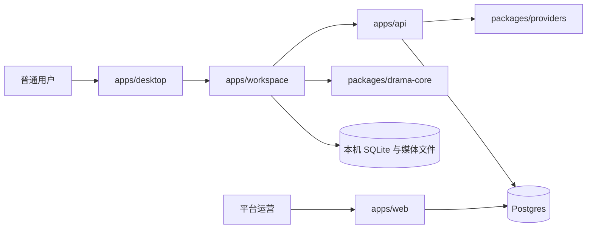

# 三份上游怎么落到开镜

一期锁定的形态是：普通用户安装 Windows 或 macOS 客户端，本机跑 Vite 工作台，薄云只负责 `cloud` 账户、积分和生成网关。`apps/web` 是平台运营后台，登录和桌面用户分开。

仓库里没有单独的 `apps/cloud`。计划里的薄云就是现在的 `apps/api`（Hono）加 `apps/web`（Next.js 运营台）。不要再新开一个应用来放登录。

| 模块 | 一期职责 |
| --- | --- |
| `apps/workspace` | 本机创作系统：首页、创作台、无限画布、素材、时间线、短剧面板、内置导演 |
| `apps/desktop` | Electron 壳。开发时加载工作台；M6 负责安装包和自动更新 |
| `apps/api` | 薄云网关：`cloud` 注册登录、积分、生成任务 |
| `apps/web` | 平台运营：用户、邀请、积分调整、任务只读。不打开用户的本机项目 |
| `packages/drama-core` | 短剧领域类型、校验和命令名。不放 React，不放供应商密钥 |
| `packages/providers` | 只在网关进程里实现的供应商适配 |
| `packages/db` | Postgres：账户、积分、生成任务元数据。不放剧本和成片 |
| `packages/ui` | 共享基础组件。短剧面板做在 `apps/workspace`，不要把画布搬进这个包 |

## 1. 上游画布：创作系统底座

来源是 Apache-2.0 的 BeatDesign，已经以提交 `174e652451a3533c20462acb7380008428670ff6` 放在 `apps/workspace`。许可和版权留在 `apps/workspace/LICENSE` 与仓库 `NOTICE`。界面产品名是开镜。

它在开镜里的角色是创作操作系统，不是短剧产品本身。短剧是加在这套操作系统上的领域层。

### 保留

这些能力已经在本机跑通，后续短剧功能必须复用，不要平行再做一套：

- 项目、创作台（Studio）、无限画布（Canvas）、素材库（Assets）、时间线（Editor）
- 本机 SQLite（Drizzle + libSQL）和本地媒体目录
- 命令内核：`project.update`、`canvas.apply`、`editor.apply`，以及卡片、时间线片段、字幕、take 等命令
- 命令信封：`commandId`、`projectId`、`origin`（`ui` / `mcp` / `cli` / `system`）、`expectedRevision`、幂等键
- 修订冲突：`REVISION_CONFLICT` 时重试，而不是让界面直接写库
- 生成谱系记在现有素材和生成记录上。短剧镜头只保存素材 id，不另造一条「这张图从哪来」的账
- MCP 进程。专业用户以后调用的是同一套命令，不是另一套私有 API

内部类型名里如果还带有上游标识，M1 到 M3 不要为了改名去大范围重命名。新写的短剧类型用 `drama` 前缀。用户看得见的窗口标题、导航和关于页只用开镜。

### 改品牌，不改行为

- 窗口标题、首页品牌、安装包名称、文档站名称是开镜 / Kaijing
- 不在界面文案里把上游项目名当作产品名
- 默认语言和官网域名按开镜：vercelai.cn。上游自带的英文、中文、日文界面可以留着，短剧面板一期以中文为主
- 创作台里现成的模型目录仍是「用户自带供应商」的高级路径。普通用户的默认路径改走薄云网关，见 [cloud.md](cloud.md)

### 要加的扩展

都加在现有项目之内，不新建第二种「短剧项目」：

- 一个短剧面板：剧本、角色、场景、道具、分镜表、导演进度
- 一组短剧命令，内部通过现有命令内核落画布和时间线
- 画布上的短剧节点，位置由画布自己记，剧情内容以短剧表为准
- 本机生成代理：向 `apps/api` 要图和视频，下载后写成现有素材

不要把工作台改成 Next.js，也不要在短剧面板里直接 `INSERT` SQLite。

## 2. Toonflow：只移植领域语义

来源是 MIT 的 Toonflow（Vue / Vue Flow）。开镜不引入它的 Vue 工程、Vue Flow 图、页面或组件。交互若要做成节点，用工作台里已经在用的 React Flow。

允许移植的是领域语义，并在 `NOTICE` 里注明思路来自该 MIT 项目。若将来真的复制某个 MIT 源文件，必须保留其版权声明；默认做法是按本文重写，不把那个仓库 vendor 进来。

要落到开镜的语义：

| Toonflow 里的概念 | 开镜里的落点 |
| --- | --- |
| 剧本 / 分镜文档 | 项目内的剧本稿和分镜表，见 [domain.md](domain.md) |
| 角色、场景资产卡 | `Character` / `Scene` / `Prop`，形象是现有 Asset |
| 画布节点和连线 | 短剧节点是领域对象的视图，不是第二份权威数据 |
| 生成时用 `@` 点名资产 | 提示词里的 `@名字` 解析成素材 id，再交给网关的 `references` |
| 文档工作区 | 短剧面板里的剧本编辑，不是另一个项目类型 |
| 多模型选择 | 普通用户只选「快速 / 标准」档位。具体供应商由网关映射，密钥不进桌面 |

明确不移植：3D 白模预演、插件市场、二十多种语言包、Vue 路由和页面结构。

## 3. 火宝短剧：只对照能力，独立实现

火宝短剧是 CC BY-NC-SA 4.0。本仓库禁止复制它的源码、界面、提示词原文、技能文件、配置和资源。也不要把它加进来当 submodule。评审时，大段来历不明的提示词或技能文本视同违规。

可以对照的只有公开能力清单，并用开镜自己的命令重新实现：

1. 一句话或小说变成剧本
2. 抽出角色、场景、道具，并去重
3. 拆成镜表
4. 为每镜写生图提示词和生视频提示词
5. 逐镜合成图像和视频
6. 把一集镜头接成片，带字幕

这些步骤对应 `packages/drama-core` 里已经占位的命令名，执行体从 M2 开始写，见 [commands.md](commands.md)。

导演技能是开镜自己的说明：按顺序调用上述命令，每步停下来给人改。它不是从火宝仓库拷来的文件。文档和 `NOTICE` 可以写「四段制作流程的产品能力参考了火宝短剧的公开介绍，实现为开镜原创」。没有火宝版权持有人的单独授权，就不能把它的代码并进本仓库，包括「只参考一下提示词」这种写法。

## 4. 模块边界（实现时不要越界）

| 问题 | 决定 |
| --- | --- |
| 剧本存在哪 | 本机 SQLite，跟项目走 |
| 成片存在哪 | 用户选的本机目录。云端不保管 MP4 |
| 谁可以调供应商 | 只有 `apps/api` 进程里的 `packages/providers` |
| 桌面持不持有平台密钥 | 不持有。高级「自带 Key」不是一期完成条件 |
| 运营能不能改一集分镜 | 不能。`apps/web` 看不到本机项目 |
| 短剧命令和画布命令谁说了算 | 剧情以短剧表为准，坐标和时间线剪辑以现有编辑器为准。同步规则见 [commands.md](commands.md) |
