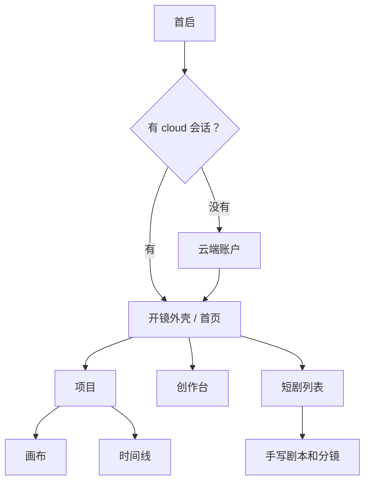

# 交互与界面设计

这组文档规定开镜一期用户看得见的界面：信息架构、每个主要屏幕、主操作和次操作、空 / 加载 / 错误 / 成功，以及屏幕之间怎么走。功能边界、表和命令以 [../design/INDEX.md](../design/INDEX.md) 为准。这里不把 [使用路径](../design/journeys.md) 再讲一遍，只规定界面该长成什么样、点下去去哪。

产品名只用「开镜」。窗口标题、导航、关于、空状态和错误文案都不使用上游项目名。

## 两套产品，两套登录

| 谁 | 在哪 | 登录 |
| --- | --- | --- |
| 桌面用户 | Windows / macOS 客户端里的本机工作台。开发期是 http://127.0.0.1:3020 ，安装包里的窗口加载同一套页面 | better-auth 的 `cloud` 实例。注册和登录在 `/cloud-account`，cookie 名 `cloud.session_token` |
| 平台运营 | `apps/web`，开发期 http://localhost:30051 | 另一份 better-auth。cookie 前缀 `web`，库 `web_auth`。公开邮箱注册关闭。受邀手机号按现有手机号插件注册 |

两套 cookie 不通用。桌面文案不出现运营后台地址。运营后台没有「打开该用户的画布 / 项目 / 成片」入口。

## 现在有的界面，和以后才出现的控件

| 界面 | 现在 | 以后才放上，现在不要假装能用 |
| --- | --- | --- |
| 外壳、首页、项目、创作台、无限画布、素材、时间线 | 已有，品牌是开镜 | M3 起短剧卡片出现在画布上；M5 起时间线接收成片镜头 |
| 云端账户的注册、登录、退出、积分余额 | 已有。余额从 0 起，注册就会有账户行 | M4 起生成才扣费。账户页不是写提示词出片的地方 |
| `/drama` 手写剧本和分镜，关掉再打开，能看见 revision | 已有。不调用模型 | 「做一集」、画质、`@` 引用、角色卡、逐镜出片、导出 MP4 |
| 安装包、签名、自动更新、官网下载 | 无 | M6 |
| 只读分享、同时编辑 | 无 | 不在这套界面里设计。一期没有分享链接、在线状态或多人光标。以后若做协作，先进入范围的只有 [导出互传](../design/collaboration.md)，那也不是多人产品 |

M2 到 M6 的按钮如果提前画进线框，必须标成未启用，不能点出「已出片」。

## 屏幕地图

平台运营是另一棵树，见 [admin.md](admin.md)。从开镜窗口到不了那棵树。

## 章节

| 文档 | 规定哪些屏幕 |
| --- | --- |
| [shell.md](shell.md) | 首启、命名、外壳、已登录和未登录 |
| [cloud-account.md](cloud-account.md) | 注册、登录、会话过期、积分 |
| [projects.md](projects.md) | 首页、项目列表、新建、打开 |
| [workspace.md](workspace.md) | 创作台、画布、素材、时间线 |
| [drama.md](drama.md) | 短剧列表和手写稿；M2–M6 控件何时出现 |
| [export-and-failures.md](export-and-failures.md) | 文件放哪、导出、失败和未保存 |
| [admin.md](admin.md) | 运营登录、用户、邀请、积分、生成任务 |

先读 `shell.md` 和 `cloud-account.md`，再按项目 → 工作台 → 短剧。各屏只写自己的文案；跨屏失败集中在 `export-and-failures.md`。
