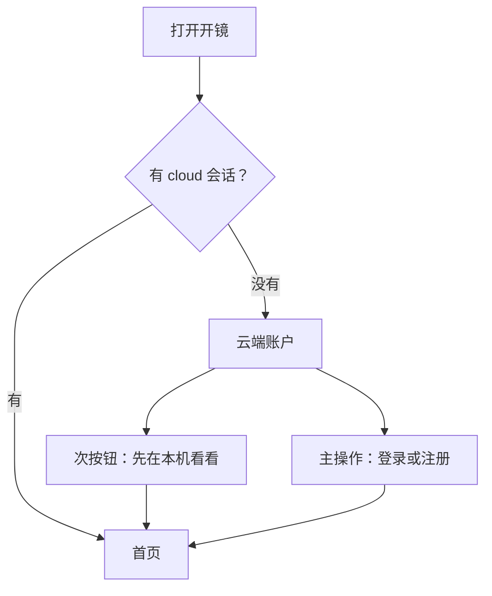

# 外壳、首启和命名

开镜窗口里只有一套工作台。普通用户不看到运营后台，也不需要打开浏览器才能创作。开发期这个窗口加载 http://127.0.0.1:3020 ；安装包（M6）加载同一套页面。

## 1. 命名

界面字符串只用这些词：

| 用户看见的 | 用这个名字 | 不用 |
| --- | --- | --- |
| 产品 | 开镜 | 上游仓库或画布项目的名字 |
| 本机创作入口 | 创作、创作台 | 把上游商标放进导航 |
| 账户 | 云端账户、未登录 | 「平台运营」「管理员注册」 |
| 短剧 | 短剧 | 用别的产品名称呼导演或分镜 |

窗口标题是「开镜」。关于和页脚可以写开源项目地址，不把上游名称做成导航项或空状态标题。

语言开关可以保留中文 / English。短剧主路径的按钮和错误用中文。不在一期做全套多语言。

## 2. 信息架构

顶层只有一条导航，从左到右：

| 项 | 去向 | 主操作 |
| --- | --- | --- |
| 首页 | `/` | 看开镜是什么，进入创作或项目 |
| 创作 | `/studio` | 新建或进入创作台 |
| 项目 | `/projects` | 打开已有本地项目 |
| 短剧 | `/drama` | 打开短剧列表 |
| 云端账户 | `/cloud-account` | 注册或登录 |

窄屏收进「打开导航」。当前项有明确的当前位置，不靠颜色单独区分。

账户位在导航右侧，和上面的「云端账户」指向同一页：

- 未登录：文字「未登录」。主操作是进入云端账户。
- 已登录：显示名字，放不下就显示邮箱。菜单两项：云端账户、退出。
- 正在确认 cookie：显示「正在确认登录」，菜单不可用。

第一次打开且没有会话时，窗口停在云端账户，见下一节。用户选「先在本机看看」之后，项目、画布和短剧手写稿不需要登录。需要云端的动作（M4 起的生图、生视频）再回到云端账户，本机已写的内容留在原处。

## 3. 首启

M6 的安装包从 vercelai.cn 下载。打开后不要求安装 Node，不打开终端，不出现供应商密钥输入框。

没有 `cloud.session_token` 时，窗口第一屏是云端账户，不是运营后台，也不是空白浏览器。主操作是在这一页登录或注册。次按钮「先在本机看看」进入首页，本机项目和手写短剧可用。已经登录则直接进入首页。

次按钮的选择记在本机。下次打开若仍未登录，不再强迫停在云端账户，改为首页上的一条提示：「登录后才能生成。」主按钮「登录开镜账户」。提示可关闭。无论哪一次，账户去向只有 `/cloud-account`，文案里不写运营后台地址。

开发期用桌面壳打开同一地址时，走同一条首启，不另做调试首页。

## 4. 已登录和未登录的外壳

| 状态 | 顶栏 | 本机页面 | 云端动作 |
| --- | --- | --- | --- |
| 未登录 | 「未登录」 | 项目、画布、短剧手写稿可用 | 点击后去云端账户，不丢当前稿 |
| 确认中 | 「正在确认登录」 | 可继续看本机内容 | 按钮暂时不可重复提交 |
| 已登录 | 名字 | 不变 | 可退出。退出只清 cookie，不删 SQLite |
| 会话过期 | 回到「未登录」，并在当前页顶部加一条可关闭提示 | 正在编辑的表单留在内存里 | 提示文案：「登录已过期，本机项目还在。」主按钮「去登录」 |

退出的确认一句即可：「退出后本机项目还在这台电脑上。」主按钮「退出」，次按钮「取消」。不要写成「删除账户」或「清空项目」。

## 5. 窗口里不出现的东西

- 运营后台的登录、邀请和封禁
- 供应商密钥、模型厂商控制台
- 分享链接、协作者头像、多人光标
- 「上传成片到云端」作为默认动作
- 上游产品名
